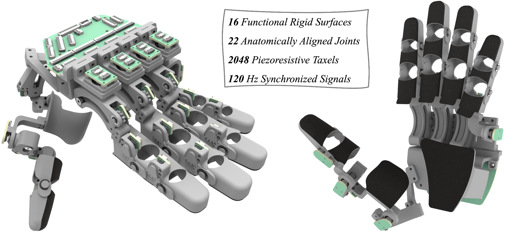
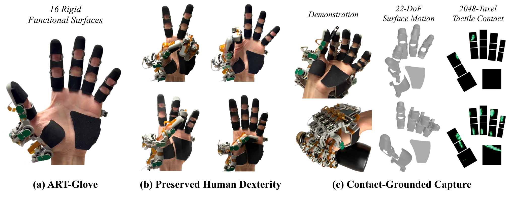

# ART-Glove



**ART-Glove: Articulated Tactile Glove for Contact-Grounded Dexterous Interaction Capture**

[Project page](https://linchangyi1.github.io/ART-Glove/) | [arXiv paper](https://arxiv.org/abs/2606.16370)

## Release plan

We are releasing the design files and code in stages, starting with the human-centric mechanical files.

- [x] Mechanical files, bill of materials, and assembly guide.
- [ ] Rigid PCBs: readout, MCU, FFC hub, and encoder boards.
- [ ] Tactile FPCBs.
- [ ] Firmware and Python tools for calibration, visualization, recording, and replay.
- [ ] Video assembly guide.
- [ ] Integrated readout PCB.
- [ ] Robot-centric version.

## Human-centric ART-Glove

[](https://arxiv.org/pdf/2606.16370)

Prepare the parts listed in the [bill of materials](hardware/human_centric/doc/bom.md) and follow the [assembly guide](hardware/human_centric/doc/guide.md) to build the glove.

## Citation

```bibtex
@article{lin2026artglove,
  title={ART-Glove: Articulated Tactile Glove for Contact-Grounded Dexterous Interaction Capture},
  author={Lin, Changyi and Zhao, Ding},
  journal={arXiv preprint arXiv:2606.16370},
  year={2026}
}
```

## Licensing

Licensing details will be announced later.
