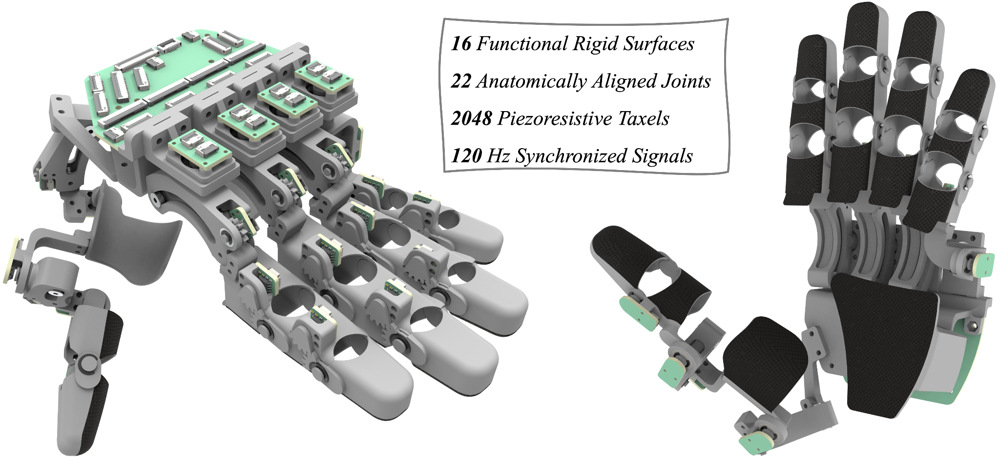
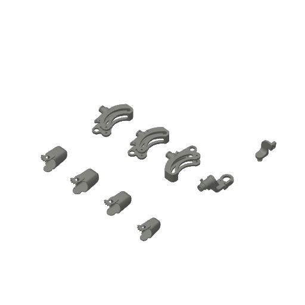
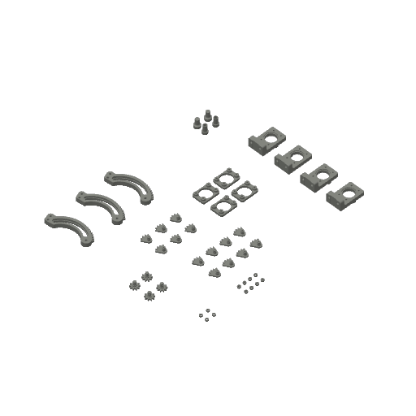
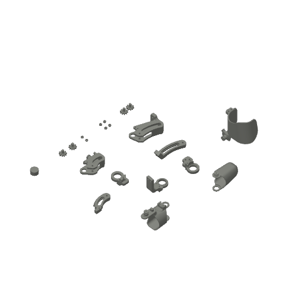
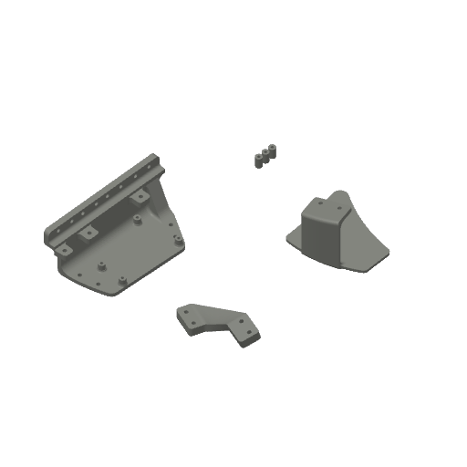

# ART-Glove hardware assembly guide

[Bill of materials](bom.md) · [Repository overview](../../../README.md)

This guide describes one **left human-centric ART-Glove V1**. Use the [STEP assembly](../step/ART-Glove-Left-V1-Simplified.step.zip) to identify the parts and check their relative positions.

Custom PCB/FPCB design files and final connection instructions will be added with the electronics release.

## Contents

1. [Material preparation](#1-material-preparation)
2. [Index, middle, and ring fingers](#2-index-middle-and-ring-fingers)
3. [Pinky](#3-pinky)
4. [Thumb](#4-thumb)
5. [Palm](#5-palm)
6. [PCB stack](#6-pcb-stack)
7. [Final connections](#7-final-connections)

## 1. Material preparation

### 1.1 Gather equipment and purchased parts

Prepare the equipment, fasteners, bearings, magnets, and materials in the [bill of materials](bom.md). Quantities in the assembly steps below are individual component counts for that step.

### 1.2 Print the five plates

Open [ART-Glove-V1-H2D_PLA.3mf](../3d_print/ART-Glove-V1-H2D_PLA.3mf). The supplied project contains five plates and the preparation for a Bambu Lab H2D using **PLA Basic** and **Support for PLA**. Inspect the plate assignments and settings before printing.

| Plate 01 | Plate 02 | Plate 03 |
| --- | --- | --- |
|  |  |  |

| Plate 04 | Plate 05 |
| --- | --- |
|  |  |

Plate 03 includes the bearing installer used in Section 2.1.

### 1.3 Cut the piezoresistive and protective layers

- **Parts:** Velostat sheet and 3M TB641 grip sheet.
- **Tools:** H2D with its cutting upgrade kit.
- **Files:** [Velostat outlines and cutting project](../2d_cut/piezo_material/) and [grip-layer outlines and cutting project](../2d_cut/3M_gripping_material/).

The folders contain DXF outlines and `.lac` cutting projects. Keep the pieces identified by finger and phalanx for the later tactile assembly steps.

### 1.4 Remove the print supports

- **Parts:** all printed parts.
- **Tools:** flush cutters.

Remove the support material before assembling the joints.

## 2. Index, middle, and ring fingers

Use the parts for the corresponding finger. The pinky uses a different MCP mechanism, described in Section 3.

### 2.1 Install the encoder-gear bearings

- **Parts:** middle and proximal shells; 2 MF63ZZ bearings.
- **Tools:** M3 × 20 mm screw, M3 nut, bearing installer from plate 03, screwdriver, and cross wrench.

Install the MF63ZZ bearings in the middle and proximal shells using the printed bearing installer.

### 2.2 Join the three phalange shells

- **Parts:** distal, middle, and proximal shells; 4 M3.5 E-clips.
- **Tools:** clip pliers.

Join the shells and retain the joints with the E-clips.

### 2.3 Install the magnets

- **Parts:** DIP, PIP, and MCP-FE gears; arc-slot part; 3 Ø1 × 1 mm and 1 Ø2 × 1 mm diametrically magnetized disc magnets.
- **Tools:** adjustable pliers and a flat, rigid object.

Install the magnets in the corresponding gear and arc-slot parts.

### 2.4 Install the DIP and PIP gears

- **Parts:** assembled shell; DIP and PIP gears; 2 M2.5 E-clips.
- **Tools:** tweezers.

Install the two gears and retain them with the E-clips.

### 2.5 Install the MCP-FE gear

- **Parts:** MCP-AA arc-slot part; MCP-FE encoder gear; 1 MF63ZZ bearing; 1 M2.5 E-clip.
- **Tools:** adjustable pliers and tweezers.

Install the bearing and MCP-FE gear in the arc-slot part, then retain the gear.

### 2.6 Install the DIP, PIP, and MCP-FE encoders

- **Parts:** assembled shell and arc-slot part; 2 DIP/PIP encoder boards; 1 MCP-FE encoder board; 4 M1.6 × 6 mm screws; 2 M1.4 × 6 mm screws; 2 M1.4 nuts.
- **Tools:** tweezers; 1.27 mm and 1.5 mm screwdrivers.

Mount the encoder boards to their corresponding shell and arc-slot locations.

### 2.7 Assemble the MCP-FE arc-slot mechanism

- **Parts:** 2 arc-slot parts; 2 thick and 1 thin ring supports; 4 MF52ZZ bearings; 2 M2.0 × 16 mm screws; 2 M2.0 lock washers; 2 M2.0 nuts.
- **Tools:** 1.5 mm screwdriver and cross wrench.

Assemble the two arc-slot parts, ring supports, and bearings using the listed fasteners. Refer to the STEP assembly for their arrangement.

### 2.8 Assemble the MCP-AA joint

- **Parts:** arc-slot assembly; MCP-AA bearing holder; 1 MF128-2RS bearing; 1 M6 E-clip.
- **Tools:** adjustable pliers and clip pliers.

Join the arc-slot assembly and bearing holder with the bearing and E-clip.

### 2.9 Assemble the tactile sensor

- **Parts:** 2 FPCB pieces; distal, middle, and proximal Velostat pieces.

Prepare the finger's tactile assembly using its FPCB pieces and the matching cut Velostat pieces. FPCB manufacturing files are scheduled for a later release.

### 2.10 Attach the tactile sensor

- **Parts:** 3 assembled parts; 2 M2.0 × 16 mm screws; 2 M2.0 nuts; 3M tape.
- **Tools:** 1.5 mm screwdriver and cross wrench.

Attach the tactile assembly to the finger parts using the listed tape and fasteners.

### 2.11 Install the MCP-AA encoder

- **Parts:** assembled part; MCP-AA support part; 1 MCP-AA encoder board; 4 M1.6 × 10 mm screws.
- **Tools:** 1.5 mm screwdriver.

Mount the MCP-AA encoder and its support.

### 2.12 Attach the protective layer

- **Parts:** assembled finger; distal, middle, and proximal 3M TB641 pieces.

Attach the corresponding protective grip pieces to the finger assembly.

## 3. Pinky

### 3.1 Build the pinky body

Use the pinky-specific parts to follow steps 2.1–2.4, the DIP/PIP encoder installation in step 2.6, and steps 2.9–2.10. Install the pinky's MCP-FE/MCP-AA encoder boards separately in step 3.4.

### 3.2 Install the MCP-FE and MCP-AA magnets

- **Parts:** MCP-AA and MCP-FE connectors; 1 Ø1 × 1 mm and 1 Ø2 × 1 mm diametrically magnetized disc magnets.
- **Tools:** adjustable pliers and a flat, rigid object.

Use the magnet-installation method from step 2.3.

### 3.3 Assemble the MCP-AA-FE joint

- **Parts:** MCP-AA and MCP-FE connectors; MCP-AA bearing holder; 1 MF128-2RS bearing; 1 MF106ZZ bearing; 1 M6.0 E-clip; 1 M4.0 E-clip.
- **Tools:** adjustable pliers and clip pliers.

Use the joint-assembly method from step 2.8 with the pinky's connectors and bearings.

### 3.4 Install the MCP-FE and MCP-AA encoders

- **Parts:** assembled part; MCP-AA support part; 1 MCP-AA encoder board; 1 semi-sphere encoder board; 4 M1.6 × 10 mm screws; 2 M1.6 × 8 mm screws.
- **Tools:** 1.5 mm screwdriver.

Mount the two encoder boards using the mounting method from step 2.11 and the pinky-specific parts.

### 3.5 Join the two assemblies

- **Parts:** the 2 assemblies; 2 M2.0 × 10 mm screws; 2 M2.0 nuts.
- **Tools:** 1.25 mm screwdriver.

Join the pinky body and MCP assembly.

## 4. Thumb

### 4.1 Install the magnets

- **Parts:** 4 parts with magnet holes; 2 gears; 6 Ø1 × 1 mm diametrically magnetized disc magnets.
- **Tools:** adjustable pliers and a flat, rigid object.

Install the six magnets in the corresponding thumb parts and gears.

### 4.2 Install the bearings

- **Parts:** 6 shells; 2 MF63ZZ bearings; 4 MF106ZZ bearings.
- **Tools:** adjustable pliers.

Install the bearings in the corresponding shells.

### 4.3 Install the gears and encoders

- **Parts:** 2 arc-slot parts; 2 gears; 2 M2.5 E-clips; 2 MCP-FE encoder boards; 4 M1.4 × 6 mm screws; 4 M1.4 nuts.
- **Tools:** tweezers and 1.27 mm screwdriver.

Fit the gears and encoder boards to the arc-slot parts and retain them with the listed E-clips and fasteners.

### 4.4 Assemble the inner MCP-AR arc-slot part

Join the two thumb joint parts to form the inner arc-slot part of the MCP-AR joint.

### 4.5 Assemble the two arc-slot mechanisms

- **Parts:** 4 arc-slot parts; 4 thick and 2 thin ring supports; 8 MF52ZZ bearings; 4 M2.0 × 16 mm screws; 4 M2.0 lock washers; 4 M2.0 nuts.
- **Tools:** 1.5 mm screwdriver and cross wrench.

Assemble both mechanisms, using the STEP assembly to identify the arrangement of the supports and bearings.

### 4.6 Connect the thumb parts

- **Parts:** 7 parts; 4 M4.0 E-clips; 4 M2.0 × 10 mm screws; 4 M2.0 nuts.
- **Tools:** clip pliers, 1.5 mm screwdriver, and cross wrench.

Join the thumb parts with the listed clips, screws, and nuts.

### 4.7 Install the four wide-D shape encoders

- **Parts:** assembled thumb; 4 wide-D shape encoders; 2 M1.6 × 4 mm screws; 6 M1.6 × 8 mm screws.
- **Tools:** 1.5 mm screwdriver.

Install the four wide-D shape encoders on the thumb assembly using the listed screws.

## 5. Palm

- **Parts:** palm rigid shell; 2 palm FPCB pieces; palm Velostat piece; palm 3M TB641 piece.

Assemble the palm with its matching tactile and protective pieces. The [cutting files](../2d_cut/) include the palm outlines.

## 6. PCB stack

- **Parts:** readout PCB; MCU and pins; MCU PCB; 2 PCB support rings; 2 M1.6 × 16 mm screws; 2 M1.6 nuts.
- **Tools:** soldering iron kit and 1.5 mm screwdriver.

Assemble the PCB stack using its support rings and fasteners. Board manufacturing files and electrical connection details will be provided with the electronics release.

## 7. Final connections

Connector assignments, cable routing, power-up checks, and calibration instructions will be provided in the next release.
